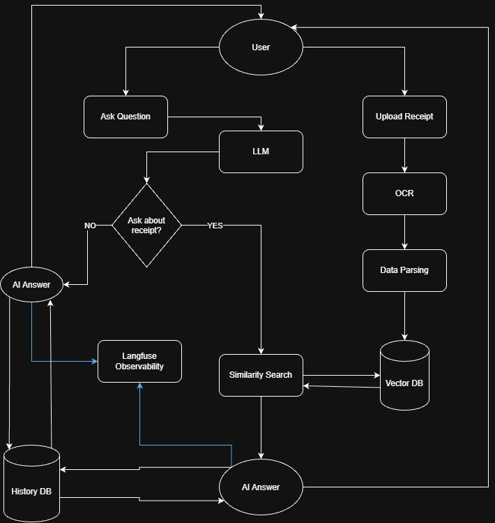

# technical-ai-engineer-test-shopee

Technical test for shopee AI engineer position

## Engineering Knowledge AI Agent Test

The results of the Engineering Knowledge AI Agent Test are available in the [Knowledge Test](./1.knowledge_test/knowledge_test.md).

## Coding Test

### Running with the full dataset (for question no 1 and 2)

Please Place the provided datasets in the `data/` directory:

```
data/
├── customer-100000.csv
└── customers-2000000.csv
```

#### **1. Please parse this csv, get the insight of the data customer-100000.csv**

Please check [customers-small](./2.coding_test/1.customers-small.ipynb) notebook for the full answer

#### **2. Please parse large CSV, customers-2000000.csv and keep the memory low.**

Please check [customers-large](./2.coding_test/2.customers-large.ipynb) notebook for the full answer

#### **3. Explain how it's different from splitting the small vs large files.**

Please check [coding_test_no3.md](./2.coding_test/3.coding_test_no3.md) for the full answer

#### **4. Deploy the vector DB on your own, and implement the `vector cosine similarity` without using a high level library.** 

Please check [docker-compose.yml](./docker-compose.yml) to see how vector DB is deployed, I'm using qdrant.
Please check [cosine-similarity.ipynb](./2.coding_test/4.cosine-similarity.ipynb) for the answer how I implement vector cosine similarity without high level library, I'm using numpy

#### **5. Create a platform with UI**

### Application workflow (for question no 5)


**Tech Stack**
- **Frontend:** Streamlit
- **Backend API:** FastAPI
- **OCR:** PaddleOCR
- **Vector Database:** Qdrant
- **AI Agent Framework:** LangChain
- **LLM:** gpt-6-luna
- **Observability:** Langfuse
- **Containerization:** Docker
- **Container Orchestration:** Docker Compose
- **CI/CD:** GitHub Actions


## How to run the app

### 1. Clone the Repository

```
git clone <repository-url>
cd technical-ai-engineer-test-shopee
```

### 2. Configure Environment Variables

Create a .env file from the example: [.env.example](.env.example)
For Docker Compose, `DATABASE_URL` must use `postgres:5432` (the Compose service
name and its internal port). The host port `5435` is only for connecting from
tools running directly on the host machine.

### 3. Start All Services

from the root project, run:
```
docker compose up --build -d
```

### 4. Verify the Services

Check the status of the running containers:
```
docker compose ps
```

### 5. Access the Application

Once the services are running, access the API documentation at:

Streamlit UI: http://localhost:8501

FastAPI Swagger UI: http://localhost:8001/docs

FastAPI ReDoc: http://localhost:8001/redoc

From another device on the same network, replace `localhost` with the host
machine's IP address (for example, `http://192.168.1.36:8501`)

### 6. Stop the Application

Stop all services:
```
docker compose down
```
Docker volumes are preserved by default, so persistent database data remains available when the services are started again.
